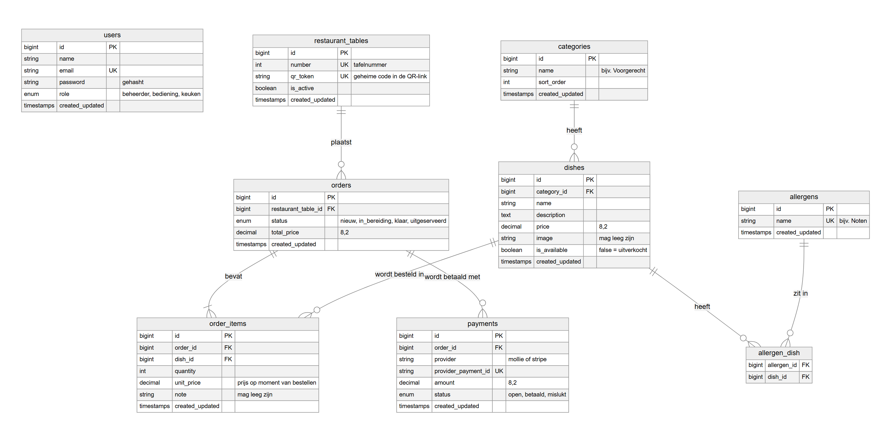

# QR-code menukaart & betaalsysteem – Backend

**Schoolproject 37** – Software Developer, mbo niveau 4 – Alfa-college Groningen

Gasten scannen de QR-code op hun tafel, bekijken de menukaart met allergenen, bestellen en betalen op hun eigen telefoon. De keuken ziet nieuwe bestellingen direct op een eigen scherm.

Dit is de **backend**: een REST API in Laravel die JSON terugstuurt naar de React-frontend.

---

## Team

| Naam | Rol |
|---|---|
| **Beam** | Projectleider, backend en database, documentatie, Git-beheer, mockups mobiel |
| **Safa** | Frontend (React), planning, mockups website |
| **Luoxi** | ERD / database-ontwerp |
| **Marouf** | Tester |

> Op 26 november heeft Salam de school verlaten. Safa heeft haar taken in de frontend overgenomen.

---

## Technieken

| Onderdeel | Techniek |
|---|---|
| Backend | Laravel 13 (PHP 8.3) |
| Database | MySQL (via MAMP) |
| Frontend | React (aparte app en repository) |
| Communicatie | REST API met JSON |
| Testen | Pest |
| Betalen | Mollie of Stripe (alleen testmodus) – nog te bouwen |
| Realtime keukenscherm | WebSockets – nog te bouwen |

---

## Installatie

### Wat heb je nodig?
- PHP 8.3 of hoger
- Composer
- Node.js en npm
- MySQL (bijvoorbeeld via MAMP)

### Stappen
1. Haal de code op:
   ```bash
   git clone https://github.com/Sachhh-star/qr-code-betaalsysteem-Backend-.git
   cd qr-code-betaalsysteem-Backend-
   ```
2. Installeer de PHP-pakketten:
   ```bash
   composer install
   ```
3. Maak je eigen `.env`-bestand en een app-sleutel:
   ```bash
   cp .env.example .env
   php artisan key:generate
   ```
4. Start **MySQL** in MAMP (alleen MySQL, niet Apache).
5. Pas in `.env` de database-regels aan:
   ```
   DB_CONNECTION=mysql
   DB_HOST=127.0.0.1
   DB_PORT=3306
   DB_DATABASE=qr_betaalsysteem
   DB_USERNAME=root
   DB_PASSWORD=root
   ```
6. Maak de tabellen aan **en** vul ze met testgegevens (Laravel vraagt of het de database mag maken → **yes**):
   ```bash
   php artisan migrate --seed
   ```
   Je krijgt dan 14 allergenen, 4 categorieën, 10 tafels, 9 gerechten en 1 testgebruiker.

   Wil je later de database helemaal **leeg maken en opnieuw opbouwen**?
   ```bash
   php artisan migrate:fresh --seed
   ```
   > ⚠️ `migrate:fresh` **verwijdert alle tabellen en gegevens**. Gebruik dit alleen op je eigen computer tijdens het ontwikkelen, **nooit** op een echte server.
7. Start de server:
   ```bash
   php artisan serve
   ```
   De backend draait nu op `http://127.0.0.1:8000`.

> ⚠️ **Let op:** het bestand `.env` staat **niet** in Git, omdat er wachtwoorden in staan. Iedereen maakt zijn eigen `.env` op basis van `.env.example`.

### Bekend probleem op Windows
Op de laptop van Beam blokkeert Windows (Smart App Control) de PHP van **Laravel Herd**. Daarom gebruiken we de PHP van **MAMP** met `php artisan serve` in plaats van een `.test`-adres van Herd.

---

## Database

Het volledige ontwerp staat in [`docs/erd.md`](docs/erd.md) en [`docs/ERD-datamodel.docx`](docs/ERD-datamodel.docx).



| Tabel | Model | Inhoud |
|---|---|---|
| `users` | `User` | Medewerkers die inloggen, met een **rol** |
| `restaurant_tables` | `RestaurantTable` | Tafels met een uniek nummer en een geheime QR-code |
| `categories` | `Category` | Groepen op de menukaart (voorgerecht, drinken …) |
| `dishes` | `Dish` | Gerechten met prijs en "uitverkocht" |
| `allergens` | `Allergen` | Lijst met allergenen |
| `allergen_dish` | – | Koppeltabel: welk gerecht heeft welke allergenen |
| `orders` | `Order` | Bestelling van een tafel met een status voor de keuken |
| `order_items` | `OrderItem` | Regels van een bestelling (gerecht, aantal, prijs) |
| `payments` | `Payment` | Betaalpogingen via Mollie of Stripe |

---

## Logboek: wat is gedaan en hoe is het getest?

### Stap 1 – Laravel installeren (19 november)
**Gedaan**
- Laravel 13 geïnstalleerd met `laravel new backend`.
- **Geen** starter kit gekozen, omdat de schermen in een **aparte frontend-app** worden gemaakt. De backend stuurt alleen JSON. (Eerst was Angular gekozen; op 26 november is het team overgestapt op React. Omdat de backend alleen JSON stuurt, hoefde daarvoor niets aan de backend te veranderen.)
- Pest gekozen als testframework.

**Getest**
- `php artisan serve` gestart en `http://127.0.0.1:8000` geopend → de welkomstpagina van Laravel was zichtbaar. ✅
- `php artisan --version` → `Laravel Framework 13.43.0`. ✅

---

### Stap 2 – MySQL koppelen (19 november)
**Gedaan**
- In `.env` de database ingesteld: `DB_CONNECTION=mysql` en `DB_DATABASE=qr_betaalsysteem`.

**Getest**
- `php artisan migrate` → Laravel maakte de database aan en de standaardtabellen kregen `DONE`. ✅
- In phpMyAdmin stond de database `qr_betaalsysteem` met 9 tabellen (`users`, `cache`, `jobs` …). ✅

**Geleerd**
- `DB_CONNECTION` is het **soort** database, `DB_DATABASE` is de **naam**.
- De database `mysql` in phpMyAdmin is een systeemdatabase van MySQL. Daar zetten we nooit eigen tabellen in.

---

### Stap 3 – Tabel `restaurant_tables` (19 november)
**Gedaan**
- Model en migration gemaakt met `php artisan make:model RestaurantTable -m`.
- Kolommen: `number` (uniek), `qr_token` (uniek), `is_active` (standaard waar).

**Getest**
- `php artisan migrate` → `create_restaurant_tables_table ... DONE`. ✅
- In MySQL gecontroleerd: `number` en `qr_token` hebben een **UNIQUE**-index, `is_active` heeft **default 1**. ✅

**Waarom zo?**
- `number` is uniek: twee tafels met hetzelfde nummer zou betekenen dat het eten bij de verkeerde tafel komt.
- `qr_token` is een geheime code. Met alleen een tafelnummer in de link zou iemand thuis voor een andere tafel kunnen bestellen.

---

### Stap 4 – Tabellen `categories` en `allergens` (20 november)
**Gedaan**
- `categories`: `name` (uniek) en `sort_order` (standaard 0).
- `allergens`: `name` (uniek).
- Model `Allergens` hernoemd naar `Allergen`, omdat een model in Laravel **enkelvoud** moet zijn.

**Getest**
- `php artisan migrate:status` → beide migrations staan op **Ran**. ✅

**Waarom zo?**
- Een naam is uniek, zodat er nooit twee keer "Drinken" of twee keer "Noten" bestaat. Bij allergenen is dat extra belangrijk voor de veiligheid van gasten.

---

### Stap 5 – Tabel `dishes` en koppeltabel `allergen_dish` (20 november)
**Gedaan**
- `dishes` met de eerste **foreign key**: `category_id` verwijst naar `categories`.
- Kolommen: `name`, `description` (lange tekst), `price` (decimal 8,2), `image` (mag leeg), `is_available` (standaard waar).
- Koppeltabel `allergen_dish` met `allergen_id` en `dish_id`, allebei met `cascadeOnDelete()`.

**Getest**
- `php artisan migrate` → beide tabellen `DONE`. ✅

**Waarom zo?**
- `dishes` kan pas gemaakt worden **nadat** `categories` bestaat, want een foreign key kan niet verwijzen naar een tabel die nog niet bestaat.
- Een gerecht kan **meerdere** allergenen hebben, en één kolom kan maar één waarde bevatten. Daarom een koppeltabel (veel-op-veel).

---

### Stap 6 – Tabellen `orders`, `order_items` en `payments` (20 en 25 november)
**Gedaan**
- `orders`: `restaurant_table_id`, `status` als **enum** (`nieuw`, `in_bereiding`, `klaar`, `uitgeserveerd`, standaard `nieuw`), `total_price`.
- `order_items`: `order_id` (met cascade), `dish_id`, `quantity`, `unit_price`, `note` (mag leeg).
- `payments`: `order_id`, `provider`, `provider_payment_id` (uniek), `amount`, `status` als enum (`open`, `betaald`, `mislukt`, standaard `open`).

**Getest**
- `php artisan migrate` → alle drie `DONE`. ✅

**Waarom zo?**
- `status` is een **enum**: de database accepteert alleen de afgesproken waarden. Een typfout zoals "klaaar" kan dus niet.
- `unit_price` wordt opgeslagen bij de bestelling. Als de prijs later verandert, kloppen oude bestellingen nog steeds.
- Bij `orders` → `restaurant_tables` en bij `payments` → `orders` is **geen** `cascadeOnDelete()` gebruikt. Bestellingen en betalingen zijn financiële gegevens en mogen niet verdwijnen. Een tafel zet je uit met `is_active = false` in plaats van hem te verwijderen.

---

### Stap 7 – Kolom `role` in `users` (25 november)
**Gedaan**
- Nieuwe migration met `php artisan make:migration add_role_to_users_table --table=users`.
- `up()`: kolom `role` als enum (`beheerder`, `bediening`, `keuken`), standaard `bediening`, na `email`.
- `down()`: kolom `role` weer verwijderen met `dropColumn('role')`.

**Getest**
- `php artisan migrate` → `DONE`. ✅
- In MySQL gecontroleerd: `role` staat na `email` en heeft default `bediening`. ✅

**Waarom zo?**
- Standaard krijgt een nieuwe gebruiker de **minste rechten** (*principle of least privilege*). Zo wordt niemand per ongeluk beheerder.

---

### Stap 8 – Relaties tussen de models (25 november)
**Gedaan**

| Model | Relaties |
|---|---|
| `Category` | `dishes()` → hasMany |
| `Dish` | `category()` → belongsTo, `allergens()` → belongsToMany |
| `Allergen` | `dishes()` → belongsToMany |
| `RestaurantTable` | `orders()` → hasMany |
| `Order` | `restaurantTable()` → belongsTo, `orderItems()` → hasMany, `payments()` → hasMany |
| `OrderItem` | `order()` → belongsTo, `dish()` → belongsTo |
| `Payment` | `order()` → belongsTo |

**Getest met Tinker** (`php artisan tinker`)
- Categorie "Hoofdgerecht" en gerecht "Pizza Margherita" aangemaakt.
- `$dish->category->name` → `"Hoofdgerecht"`. ✅ (belongsTo werkt)
- `$category->dishes` → lijst met "Pizza Margherita". ✅ (hasMany werkt)
- Allergeen "Gluten" aan de pizza gekoppeld: `$dish->allergens` → "Gluten" en `$allergen->dishes` → "Pizza Margherita". ✅ (belongsToMany werkt via `allergen_dish`)
- `$table->orders()` en `$order->orderItems()` → geven een HasMany-relatie terug. ✅

**Geleerd**
- De kant met de foreign key gebruikt `belongsTo`, de andere kant `hasMany`.
- Bij veel-op-veel gebruiken beide kanten `belongsToMany`.
- Een functie die **één** ding teruggeeft heeft een enkelvoudige naam (`category`), een functie die **meerdere** dingen teruggeeft een meervoudige naam (`dishes`).

---

### Stap 9 – `Fillable` in de models (25 november)
**Gedaan**
- In alle 7 eigen models een `#[Fillable([...])]` toegevoegd, met alle kolommen behalve `id` en de timestamps.

| Model | Fillable |
|---|---|
| `RestaurantTable` | `number`, `qr_token`, `is_active` |
| `Category` | `name`, `sort_order` |
| `Allergen` | `name` |
| `Dish` | `category_id`, `name`, `description`, `price`, `image`, `is_available` |
| `Order` | `restaurant_table_id`, `status`, `total_price` |
| `OrderItem` | `order_id`, `dish_id`, `quantity`, `unit_price`, `note` |
| `Payment` | `order_id`, `provider`, `provider_payment_id`, `amount`, `status` |

**Getest met Tinker**
- Met `create([...])` in één keer een tafel, categorie, allergeen, gerecht, bestelling, bestelregel en betaling gemaakt. Er kwam **geen** `MassAssignmentException`. ✅
- Standaardwaarden werken: een nieuwe tafel is actief (`is_active = 1`), een nieuwe bestelling heeft status `nieuw`, een nieuwe betaling heeft status `open`. ✅
- `$order->orderItems()->count()` → `1`. ✅
- **Beveiligingstest:** een gebruiker gemaakt met `role => 'beheerder'` erbij. Omdat `role` **niet** in de Fillable van `User` staat, werd dat genegeerd: de gebruiker kreeg de standaardrol `bediening`. Het wachtwoord werd automatisch **gehasht** opgeslagen. ✅
- Alle testgegevens daarna weer verwijderd.

**Waarom zo?**
- *Mass assignment* is het in één keer invullen van meerdere kolommen. Met `Fillable` leggen we vast welke kolommen dat mogen. Velden die niet in de lijst staan, worden genegeerd.
- `role` staat bewust **niet** in de Fillable van `User`. Anders zou iemand bij het registreren zelf `role = beheerder` kunnen meesturen. De rol wordt later alleen door een beheerder ingesteld.

---

### Stap 10 – Seeder voor allergenen (25 november)
**Gedaan**
- Seeder gemaakt met `php artisan make:seeder AllergenSeeder`.
- In `run()` een lijst met de **14 allergenen** die in de EU verplicht zijn: Gluten, Schaaldieren, Eieren, Vis, Pinda's, Soja, Melk, Noten, Selderij, Mosterd, Sesamzaad, Sulfiet, Lupine en Weekdieren.
- Met een `foreach`-lus wordt voor elke naam één allergeen gemaakt met `Allergen::create(['name' => $name])`.

**Getest**
- `php artisan db:seed --class=AllergenSeeder` → `DONE`. ✅
- In de database gecontroleerd: er staan precies **14** allergenen in de tabel. ✅
- De seeder een **tweede keer** uitgevoerd → foutmelding `Duplicate entry 'Gluten' for key 'allergens_name_unique'`. ✅ Dit bewijst dat de `unique()`-regel uit de migration werkt: hetzelfde allergeen kan nooit twee keer bestaan.
- Daarna `create` vervangen door **`firstOrCreate`** en de seeder opnieuw uitgevoerd → `DONE` zonder foutmelding, en nog steeds precies **14** allergenen (geen dubbele). ✅

**Waarom `firstOrCreate`?**
- `firstOrCreate` zoekt eerst of het allergeen al bestaat. Bestaat het al, dan doet hij niets. Zo kan iedereen in het team de seeder veilig meerdere keren uitvoeren.

**Waarom zo?**
- Met een seeder krijgt iedereen in het team (ook Safa voor de frontend) met één commando **dezelfde testgegevens**.
- Een seeder vult de database **één keer** bij het opzetten van het project. De app zelf leest de gegevens daarna alleen uit de database.

---

### Stap 11 – Seeder voor categorieën (25 november)
**Gedaan**
- Seeder gemaakt met `php artisan make:seeder CategorySeeder`.
- Een lijst met **naam => volgorde**: Voorgerecht (1), Hoofdgerecht (2), Nagerecht (3), Drinken (4).
- Met `foreach ($categories as $name => $order)` en `Category::firstOrCreate(['name' => $name], ['sort_order' => $order])`.

**Getest**
- `php artisan db:seed --class=CategorySeeder` → `DONE`. ✅
- In phpMyAdmin (`categories` → Browse) staan 4 categorieën. ✅
- `Hoofdgerecht` bestond al (uit de Tinker-test van stap 8). `firstOrCreate` heeft hem **gevonden** en geen tweede gemaakt. ✅ Daarom heeft deze nog `sort_order = 0`. Dit lossen we op door de database straks schoon op te bouwen.

**Waarom zo?**
- `firstOrCreate` heeft twee delen: het **eerste deel** gebruikt hij om te **zoeken**, het **tweede deel** vult hij alleen in als hij een **nieuwe** rij maakt.
- We zoeken op `name`, omdat die kolom **uniek** is. Op `sort_order` zoeken kan niet, want twee categorieën kunnen hetzelfde volgnummer hebben.

---

### Stap 12 – Seeder voor tafels (25 november)
**Gedaan**
- Seeder gemaakt met `php artisan make:seeder RestaurantTableSeeder`.
- Met een `for`-lus van 1 tot en met 10 worden **10 tafels** gemaakt.
- Elke tafel krijgt een willekeurige `qr_token` van 32 tekens met `Str::random(32)`.
- `RestaurantTable::firstOrCreate(['number' => $i], ['qr_token' => Str::random(32)])`.

**Getest**
- `php artisan db:seed --class=RestaurantTableSeeder` → `DONE`. ✅
- In de database: **10 tafels** (nummer 1 t/m 10), **10 verschillende** tokens van 32 tekens, en alle tafels actief (`is_active = 1`). ✅
- De seeder een **tweede keer** uitgevoerd → `DONE`, nog steeds 10 tafels, en de token van tafel 1 is **niet veranderd**. ✅

**Waarom zo?**
- We zoeken op `number` (uniek en vast). De `qr_token` staat in het tweede deel, zodat hij alleen bij het **maken** van een tafel wordt bedacht.
- De `qr_token` blijft daarna **altijd hetzelfde**, ook als er nieuwe gasten aan de tafel komen. De QR-code wordt namelijk als sticker op de tafel geplakt. Elke gast maakt wel een **nieuwe bestelling** (`orders`) die bij die tafel hoort.
- Een willekeurige token is veiliger dan alleen het tafelnummer: niemand kan raden welke link bij een andere tafel hoort.

---

### Stap 13 – Seeder voor gerechten met allergenen (26 november)
**Gedaan**
- Seeder gemaakt met `php artisan make:seeder DishSeeder`.
- Een lijst met **9 gerechten**. Per gerecht: naam, **naam** van de categorie, beschrijving, prijs en een lijst met allergenen.
- In een `foreach`-lus per gerecht drie stappen:
  1. De categorie zoeken op naam: `Category::where('name', ...)->first()`.
  2. Het gerecht maken: `Dish::firstOrCreate(['name' => ...], ['category_id' => ..., 'description' => ..., 'price' => ...])`.
  3. De allergenen koppelen: `Allergen::whereIn('name', [...])->pluck('id')` en daarna `$dish->allergens()->sync(...)`.

**Getest**
- `php artisan db:seed --class=DishSeeder` → zonder fouten. ✅
- In de database: **9 gerechten**, elk met de juiste categorie. ✅
- In de koppeltabel `allergen_dish`: **15 rijen**, precies het aantal allergenen uit de lijst. ✅
- In Tinker: `Dish::where('name', 'Chocoladetaart')->first()->allergens->pluck('name')` → `Eieren, Gluten, Melk, Noten`. ✅
- Fruitsalade en Cola hebben **geen** allergenen. ✅
- Pizza Margherita bestond al uit de Tinker-test en is **niet dubbel** gemaakt. Wel heeft hij daardoor nog de oude prijs (€ 10,50 in plaats van € 12,50). Dit lossen we op door de database schoon op te bouwen.

**Waarom zo?**
- In de seeder staat de **naam** van de categorie en niet het `id`. Een `id` kan op elke computer anders zijn (bij Beam heeft "Voorgerecht" id 3, bij Safa misschien id 1). De naam is overal hetzelfde.
- `where` zoekt op **één** waarde, `whereIn` zoekt op **meerdere** waarden tegelijk.
- `sync` zorgt dat een gerecht **precies** de allergenen uit de lijst heeft: niet meer en niet minder.

---

### Stap 14 – Alle seeders samen en de database schoon opbouwen (26 november)
**Gedaan**
- In `DatabaseSeeder` alle seeders aangeroepen met `$this->call([...])`, in deze volgorde:
  1. `AllergenSeeder`
  2. `CategorySeeder`
  3. `RestaurantTableSeeder`
  4. `DishSeeder`
- De database helemaal opnieuw opgebouwd met `php artisan migrate:fresh --seed`.

**Getest**
- Alle migrations en alle 4 seeders gaven `DONE`. ✅
- Daarna in de database gecontroleerd:

| Tabel | Resultaat | |
|---|---|---|
| `users` | 1 testgebruiker met rol `bediening` | ✅ |
| `allergens` | 14 | ✅ |
| `categories` | 4, met id 1 t/m 4 en `sort_order` 1 t/m 4 (Hoofdgerecht heeft nu goed volgnummer 2) | ✅ |
| `restaurant_tables` | 10, met id 1 t/m 10 (geen gaten meer) | ✅ |
| `dishes` | 9, Pizza Margherita kost nu goed € 12,50 | ✅ |
| `allergen_dish` | 15 | ✅ |
| `orders`, `order_items`, `payments` | leeg (die komen later via de app) | ✅ |

**Waarom zo?**
- De **volgorde** is belangrijk. `DishSeeder` zoekt categorieën en allergenen op. Als die nog niet bestaan, vindt `first()` niets (`null`) en krijg je de fout *"Attempt to read property 'id' on null"*. Daarom eerst de tabellen vullen **waar naar verwezen wordt**, net als bij de migrations.
- Met `migrate:fresh --seed` zijn de oude testgegevens uit Tinker weg en is de database bij **iedereen in het team hetzelfde**.

---

## Git-geschiedenis

| Datum | Commit |
|---|---|
| 19-11 | first-commit |
| 20-11 | Migrations voor tafels, categorieën en allergenen |
| 20-11 | Migrations voor gerechten en allergenen-koppeltabel |
| 25-11 | Migrations voor bestellingen en bestelregels |
| 25-11 | Migration voor betalingen |
| 25-11 | Rol-kolom toegevoegd aan users |
| 25-11 | Relaties tussen models toegevoegd |
| 25-11 | Fillable in models, README en ERD-documenten |
| 25-11 | Seeder voor de 14 allergenen |
| 25-11 | Seeder voor categorieën |
| 25-11 | Seeder voor tafels |
| 26-11 | Seeder voor gerechten, teamwijziging en overstap naar React |

---

## Nog te doen

- [x] `Fillable` in alle models
- [x] Seeder voor de 14 allergenen
- [x] Seeder voor categorieën
- [x] Seeder voor tafels
- [x] Seeder voor gerechten (met allergenen)
- [x] Alle seeders samen in `DatabaseSeeder` en database schoon opbouwen
- [ ] API-routes en controllers (JSON) – afspreken met Safa
- [ ] Validatie van invoer
- [ ] Inloggen voor personeel (Laravel Sanctum) en rechten per rol
- [ ] QR-code per tafel
- [ ] Realtime keukenscherm (WebSockets)
- [ ] Betalen met Mollie of Stripe (testmodus)
- [ ] Tests met Pest
- [ ] Beveiliging controleren (SQL-injectie, XSS)
