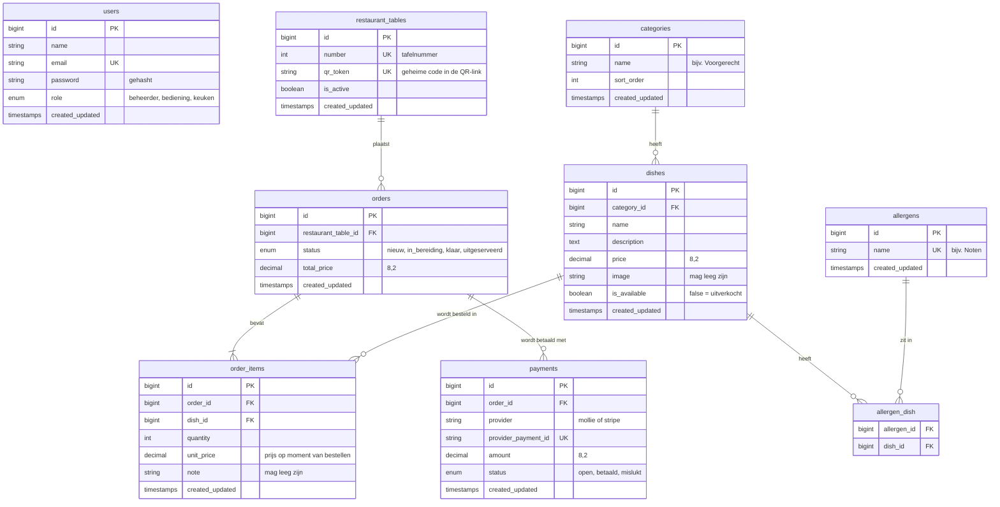

# ERD – Datamodel

**Project:** 37 – QR-code menukaart & betaalsysteem
**Fase:** Week 2 – datamodel en technisch ontwerp
**Status:** concept – Luoxi controleert en past aan waar nodig

---

## Uitleg

**Wat is een ERD?**
ERD betekent *Entity Relationship Diagram*.
Het is een tekening van de tabellen in de database.
Je ziet welke gegevens in elke tabel staan.
Je ziet ook hoe de tabellen bij elkaar horen.

**Waarom Engelse namen?**
Laravel werkt met Engelse namen. Een tabel heet bijvoorbeeld `dishes` en het model heet `Dish`.
Laravel kan dan zelf de verbanden tussen tabellen vinden.

**Afkortingen in de tekening**
- **PK** (primary key): het unieke nummer van een rij.
- **FK** (foreign key): een verwijzing naar een rij in een andere tabel.
- **UK** (unique key): deze waarde mag maar één keer voorkomen.

---

## De tekening

> Open dit bestand in VS Code met `Ctrl+Shift+V` (installeer eventueel de extensie *Markdown Preview Mermaid Support*), of bekijk het op GitHub. Dan zie je de tekening.

---

## De tabellen

| Tabel | Wat staat erin? | User stories |
|---|---|---|
| **users** | Medewerkers die kunnen inloggen, met hun rol. Gasten staan hier **niet** in. | US-13, US-14 |
| **restaurant_tables** | De tafels in het restaurant. Elke tafel heeft een eigen QR-code. | US-01, US-12 |
| **categories** | Groepen op de menukaart, zoals voorgerecht, hoofdgerecht en drinken. | US-01, US-11 |
| **dishes** | De gerechten met naam, prijs en of ze uitverkocht zijn. | US-03, US-10, US-11 |
| **allergens** | De lijst met allergenen, zoals noten, gluten en melk. | US-02 |
| **allergen_dish** | Koppelt gerechten aan allergenen. | US-02, US-11 |
| **orders** | Een bestelling van één tafel, met de status voor de keuken. | US-04, US-06, US-07, US-08, US-09 |
| **order_items** | De regels van een bestelling: welk gerecht en hoeveel. | US-03, US-04 |
| **payments** | De betalingen via Mollie of Stripe (testmodus). | US-05 |

---

## De verbanden

| Verband | Soort | Uitleg |
|---|---|---|
| categories → dishes | **1 op veel** | Eén categorie heeft veel gerechten. Een gerecht hoort bij één categorie. |
| dishes ↔ allergens | **veel op veel** | Eén gerecht kan veel allergenen hebben. Eén allergeen kan in veel gerechten zitten. Daarom is er een **koppeltabel** `allergen_dish`. |
| restaurant_tables → orders | **1 op veel** | Eén tafel kan veel bestellingen plaatsen. Een bestelling hoort bij één tafel. |
| orders → order_items | **1 op veel** | Eén bestelling heeft één of meer regels. |
| dishes → order_items | **1 op veel** | Eén gerecht kan in veel bestelregels staan. |
| orders → payments | **1 op veel** | Eén bestelling kan meer betaalpogingen hebben, bijvoorbeeld als de eerste mislukt. |

---

## Belangrijke keuzes

**1. Waarom heet de tabel `restaurant_tables` en niet `tables`?**
"Table" betekent in een database al iets: een tabel. Dat is verwarrend. `restaurant_tables` is duidelijker.

**2. Waarom heeft een tafel een `qr_token`?**
In de QR-code staat een link, bijvoorbeeld `.../menu/a8f3k2`. Als we alleen het tafelnummer gebruiken (`.../menu/5`), kan iemand thuis het nummer veranderen en voor een andere tafel bestellen. Een geheime, willekeurige code is veiliger.

**3. Waarom staat `unit_price` in `order_items`?**
De prijs van een gerecht kan later veranderen. Als we de prijs bij de bestelling opslaan, blijft een oude bestelling altijd kloppen.

**4. Waarom een aparte tabel `payments`?**
Een betaling kan mislukken. De gast probeert het dan opnieuw. Zo bewaren we elke poging. Ook kunnen we later makkelijk wisselen tussen Mollie en Stripe.

**5. Waarom staan gasten niet in `users`?**
Gasten loggen niet in. Een bestelling hoort bij een **tafel**, niet bij een persoon. Zo hoeft de gast niets in te vullen en blijft bestellen binnen 2 minuten.

**6. Waarom een `role` in `users`?**
Zo weet de app wat een medewerker mag. De keuken ziet het keukenscherm, de beheerder kan het menu aanpassen. Dit hoort bij de beveiliging (US-14, US-17).

---

## Volgorde van de migrations

Een tabel met een **FK** kan pas gemaakt worden als de tabel waar hij naar verwijst al bestaat. Daarom maken we ze in deze volgorde:

1. `users` – bestaat al (aanpassen: kolom `role` toevoegen)
2. `restaurant_tables`
3. `categories`
4. `allergens`
5. `dishes` – verwijst naar `categories`
6. `allergen_dish` – verwijst naar `dishes` en `allergens`
7. `orders` – verwijst naar `restaurant_tables`
8. `order_items` – verwijst naar `orders` en `dishes`
9. `payments` – verwijst naar `orders`
